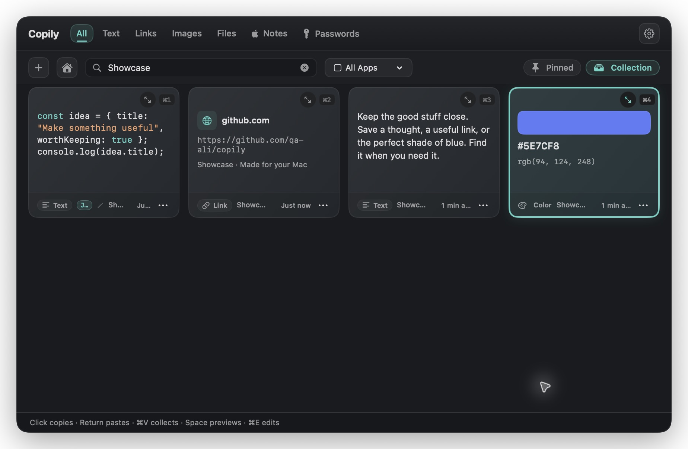
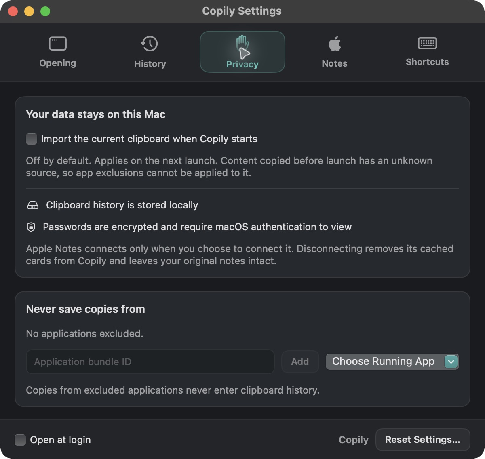

# Copily

### A little less retyping. A lot more flow.

Your clipboard, ready when you need it. A native, open-source clipboard manager for macOS.

**[Download for Mac (.dmg)](https://github.com/Free-Apps-4-You/copily/releases/download/v0.1.0/Copily-0.1.0-arm64.dmg)** · [Application ZIP](https://github.com/Free-Apps-4-You/copily/releases/download/v0.1.0/Copily-0.1.0-arm64.zip) · [Releases](https://github.com/Free-Apps-4-You/copily/releases)

Apple Silicon · macOS 14+ · [MIT licensed](LICENSE)

## Keep the good stuff close

- **Find that copy.** Search text, links, images, and files, or filter by the app they came from.
- **Save your favorites.** Pin useful clips and keep reusable snippets in Collection.
- **See more at a glance.** Preview images, highlighted code, and colors with HEX/RGB copy controls.
- **Make quick edits.** Update saved text and labels without switching apps.
- **Bring your notes along.** Connect Apple Notes when you want to browse and search your notes.
- **Stay in control.** Local clipboard history, app exclusions, pause controls, and adjustable retention.

## Made to stay out of your way

Open Copily from the menu bar, hover over your MacBook notch, or press **⌥⌘V**.
Click a card to copy it, press **Return** to paste, or **Space** for a closer look.
Auto-paste requires Accessibility permission; copying works without it.

| Colors, without the guesswork | Your clipboard, your choices |
| :---: | :---: |
|  |  |

*Screenshots use sample content.*

## Get started

1. [Download the DMG](https://github.com/Free-Apps-4-You/copily/releases/download/v0.1.0/Copily-0.1.0-arm64.dmg).
2. Open it and drag **Copily** into **Applications**.
3. Launch Copily and start copying.

The current preview is ad-hoc signed and not notarized. macOS may block installation.

## Open source, open to ideas

Copily is free and open source under the [MIT license](LICENSE).
Found a bug or have an idea? [Open an issue](https://github.com/Free-Apps-4-You/copily/issues/new) or send a pull request.

[Contributing](CONTRIBUTING.md) · [Third-party notices](THIRD_PARTY_NOTICES.md)
