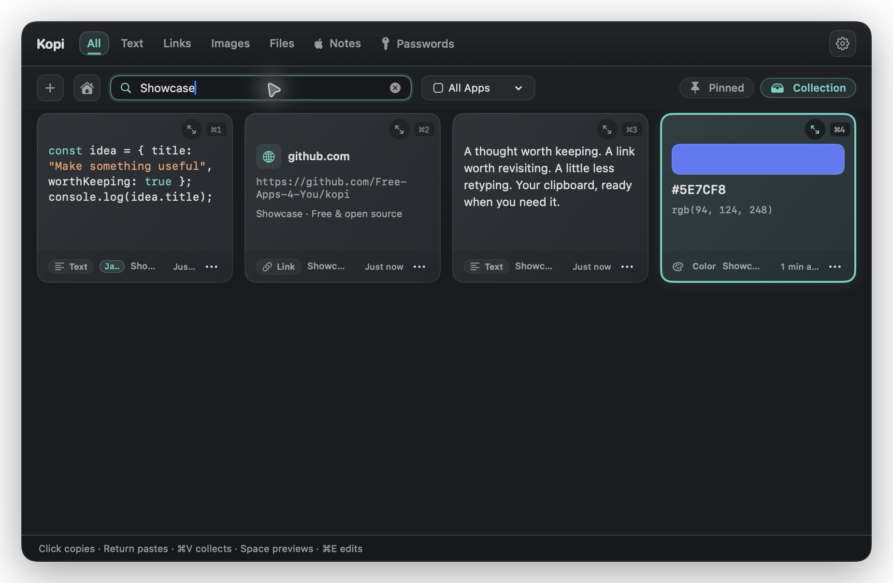
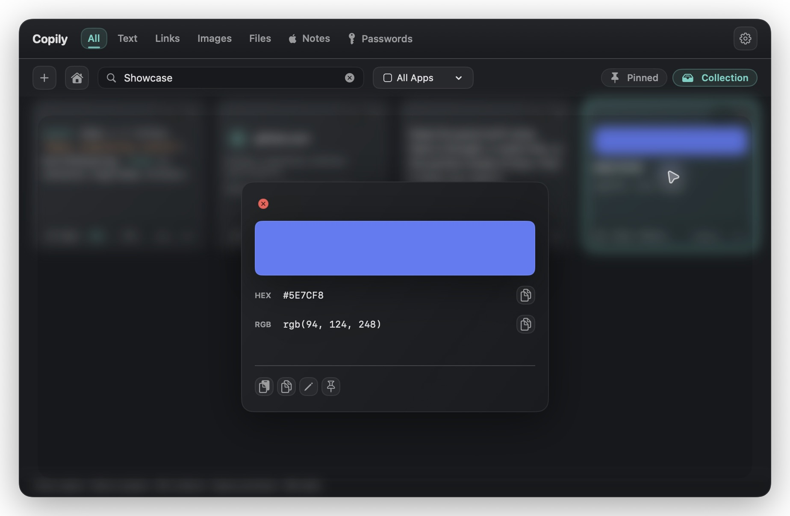
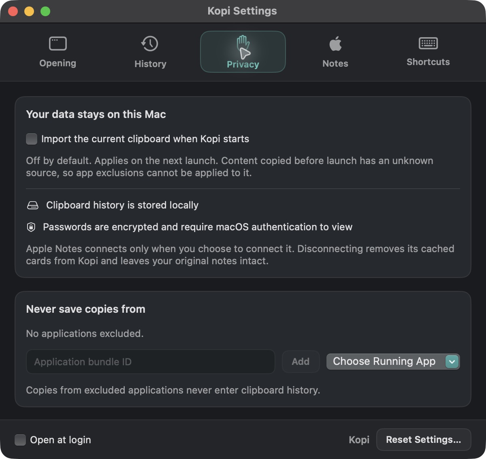

# Kopi

### A little less retyping. A lot more flow.

Your clipboard, ready when you need it. A native, open-source clipboard manager for macOS.

**Download for Mac: [Apple Silicon (.dmg)](https://github.com/Free-Apps-4-You/kopi/releases/latest/download/Kopi-Apple-Silicon-Mac.dmg) · [Intel (.dmg)](https://github.com/Free-Apps-4-You/kopi/releases/latest/download/Kopi-Intel-Mac.dmg)**

[Apple Silicon ZIP](https://github.com/Free-Apps-4-You/kopi/releases/latest/download/Kopi-Apple-Silicon-Mac.zip) · [Intel ZIP](https://github.com/Free-Apps-4-You/kopi/releases/latest/download/Kopi-Intel-Mac.zip) · [Releases](https://github.com/Free-Apps-4-You/kopi/releases)

Intel & Apple Silicon · macOS 14+ · [MIT licensed](LICENSE)

## Keep the good stuff close

- **Formatting that stays with your clips.** Edit text with headings, lists, checklists, tables, colors, and inline styles. Preview and copy Apple Notes with formatting; Notes stay read-only.
- **A clipboard at your pointer.** Hold ⌥Space, point at a card, and release to copy. Preview recent clips and images, and scroll or press ← → for older copies.
- **Find that copy.** Search text, links, images, and files, or filter by the app they came from.
- **Save your favorites.** Pin useful clips and keep reusable snippets in Collection.
- **See more at a glance.** Preview images, highlighted code, and colors with HEX/RGB copy controls.
- **Make quick edits.** Update saved text and labels without switching apps.
- **Bring your notes along.** Browse and search Apple Notes with **All**, **On My Mac**, and **iCloud** filters. Kopi only reads and copies notes; make edits in Apple Notes.
- **Stay in control.** Local clipboard history, app exclusions, pause controls, and adjustable retention.

## Made to stay out of your way

Open Kopi from the menu bar, hover over your MacBook notch or the top-center edge of any display, or press **⌥⌘V**.
Click a card to copy it, press **Return** to copy, or **Space** for a closer look.
Radial clipboard is on by default. Use **↑ ↓** or **1–8** to select a clip, **Return** to confirm, and **Esc** to cancel. Choose copy-only mode, change its hold shortcut, or switch it off in **Settings → Opening**.
Select a clip to copy it, then press ⌘V in your destination app.

| Colors, without the guesswork | Your clipboard, your choices |
| :---: | :---: |
|  |  |

*Screenshots use sample content.*

## Get started

1. Download the DMG for your Mac: [Apple Silicon](https://github.com/Free-Apps-4-You/kopi/releases/latest/download/Kopi-Apple-Silicon-Mac.dmg) or [Intel](https://github.com/Free-Apps-4-You/kopi/releases/latest/download/Kopi-Intel-Mac.dmg). Check **Apple menu → About This Mac** if you're unsure.
2. Open it and drag **Kopi** into **Applications**.
3. Launch Kopi and start copying.

The current preview is ad-hoc signed and not notarized. macOS may block installation.

## Open source, open to ideas

Kopi is free and open source under the [MIT license](LICENSE).
Found a bug or have an idea? [Open an issue](https://github.com/Free-Apps-4-You/kopi/issues/new) or send a pull request.

[Contributing](CONTRIBUTING.md) · [Third-party notices](THIRD_PARTY_NOTICES.md)
